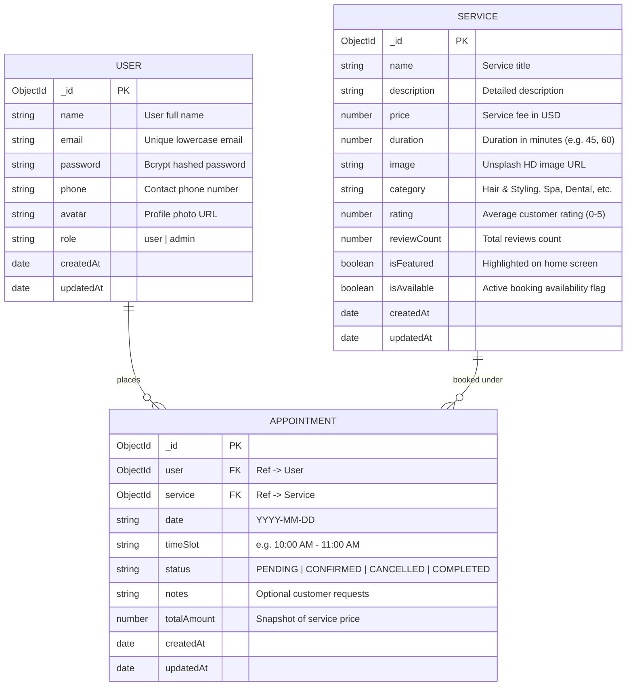

# Database Schema & Entity-Relationship (ER) Documentation

## Overview
The **Service Booking & Management** backend uses a relational data model implemented over **MongoDB** via **Mongoose ORM**, with strict schema validation, referential integrity checks, and compound indexes to prevent double booking.

---

## Entity-Relationship (ER) Diagram

---

## Collections Details

### 1. `users` Collection
Stores customer and administrator profiles.
- **Indexes**:
  - `email`: Unique index for quick lookup and login.
- **Security**:
  - `password`: Stored as a salted Bcrypt hash with salt rounds = 10. Stripped from all JSON serialization (`select: false`).

| Field | Type | Required | Description |
|---|---|---|---|
| `_id` / `id` | ObjectId / String | Yes | Primary Key |
| `name` | String | Yes | Minimum 2 characters, max 60 |
| `email` | String | Yes | Unique, valid email pattern |
| `password` | String | Yes | Min 6 characters, Bcrypt hashed |
| `phone` | String | No | Contact number |
| `avatar` | String | No | URL to user's profile image |
| `role` | String (Enum) | Yes | `'user'` or `'admin'` (default: `'user'`) |
| `createdAt` | Date | Auto | Timestamp |
| `updatedAt` | Date | Auto | Timestamp |

---

### 2. `services` Collection
Represents the catalog of bookable offerings.
- **Indexes**:
  - `category`: B-Tree index for category filtering.
  - `isFeatured`: B-Tree index for home screen queries.
  - `isAvailable`: Filter inactive services.
  - Text Index on `{ name, description, category }` for search.

| Field | Type | Required | Description |
|---|---|---|---|
| `_id` / `id` | ObjectId / String | Yes | Primary Key |
| `name` | String | Yes | Service title |
| `description` | String | Yes | In-depth description |
| `price` | Number | Yes | Pricing (min: 0) |
| `duration` | Number | Yes | Duration in minutes |
| `image` | String | Yes | Image URL |
| `category` | String | Yes | Service category |
| `rating` | Number | No | Default: 4.8 |
| `reviewCount` | Number | No | Default: 25 |
| `isFeatured` | Boolean | Yes | Default: `false` |
| `isAvailable` | Boolean | Yes | Default: `true` |

---

### 3. `appointments` Collection
Stores booking records linking a specific user to a service at a specific date and time slot.
- **Indexes**:
  - Compound Index: `{ service: 1, date: 1, timeSlot: 1, status: 1 }`
    - Used to guarantee **double booking prevention** at the database query level.
  - Compound Index: `{ user: 1, date: 1 }`
    - Used for quick retrieval of user booking history (Upcoming vs. Past).

| Field | Type | Required | Description |
|---|---|---|---|
| `_id` / `id` | ObjectId / String | Yes | Primary Key |
| `user` | ObjectId (Ref: User) | Yes | Foreign Key to `users` |
| `service` | ObjectId (Ref: Service) | Yes | Foreign Key to `services` |
| `date` | String | Yes | Format `YYYY-MM-DD` |
| `timeSlot` | String | Yes | Selected time slot (e.g. `10:00 AM - 11:00 AM`) |
| `status` | String (Enum) | Yes | `PENDING`, `CONFIRMED`, `CANCELLED`, `COMPLETED` |
| `notes` | String | No | Optional notes (max 500 chars) |
| `totalAmount` | Number | Yes | Price snapshot |

---

## Conflict Prevention Mechanism
To satisfy **Assessment Section 3.C ("Validate appointment availability and prevent conflicting bookings")**:
1. When `POST /api/appointments` is invoked:
   - Check if an appointment exists with matching `(serviceId, date, timeSlot)` where status is `PENDING` or `CONFIRMED`. If found, returns `409 Conflict`.
   - Check if the current authenticated user already has an appointment with matching `(userId, date, timeSlot)`. If found, returns `409 Conflict`.
2. When checking slots via `GET /api/appointments/available-slots?serviceId=...&date=...`:
   - Checks all standard slots against booked non-cancelled records.
   - Marks booked slots with `isAvailable: false`, enabling the Flutter app to disable booked time slot chips in the UI!
